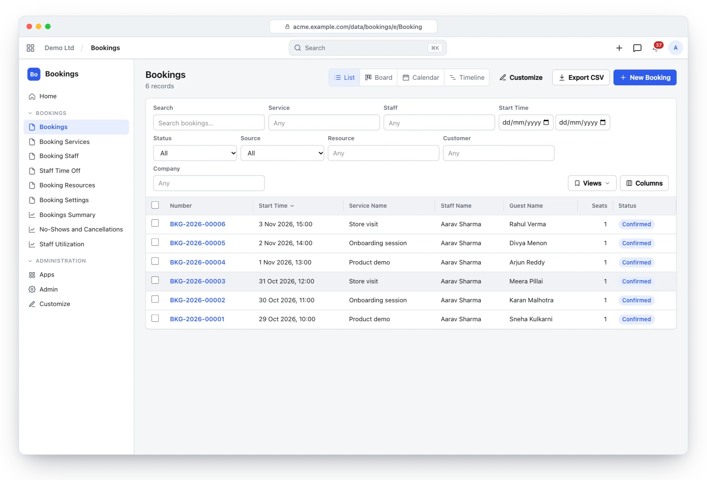
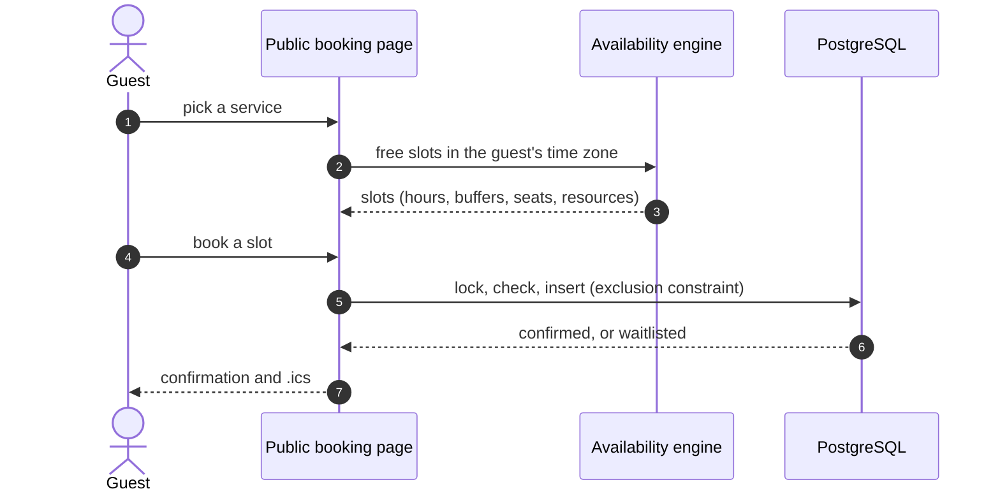
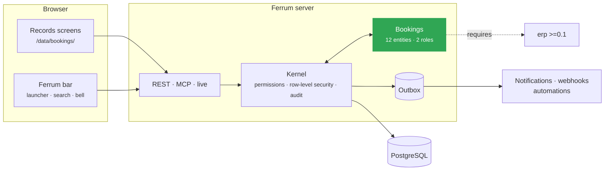
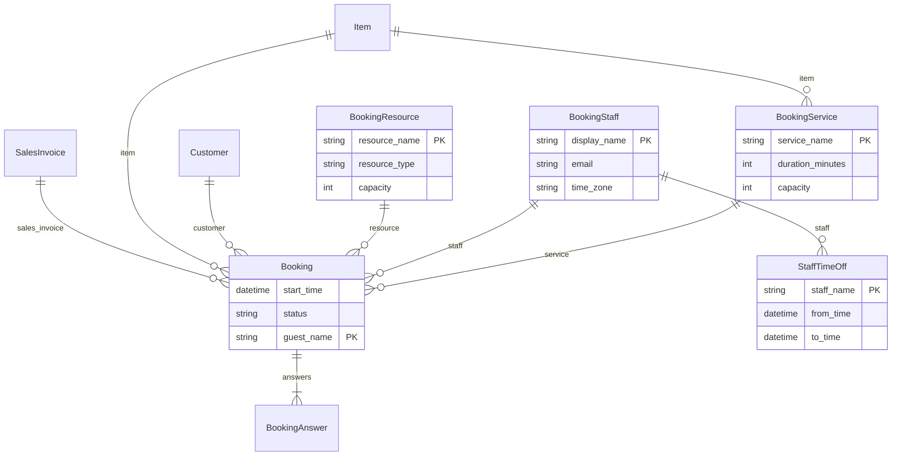

<div align="center">

<picture>
  <source media="(prefers-color-scheme: dark)" srcset="docs/assets/banner-dark.svg">
  
</picture>

[](https://github.com/CBFerrum/ferrum-app-bookings/actions/workflows/ci.yml)     

**A native app for [Ferrum](https://github.com/CBFerrum/Ferrum), the open-source, AI-first business platform.**

[Overview](#overview) · [Highlights](#highlights) · [Screenshots](#screenshots) · [How it works](#how-it-works) · [Data model](#data-model) · [Install](#install) · [Develop](#develop) · [Changelog](#changelog)

</div>

---

## Overview

Ferrum Bookings schedules appointments and group classes. Staff work in their own time zones
across several intervals a day; rooms and equipment have capacities; a heavily tested availability
engine handles daylight saving, buffers and notice windows; and double booking is impossible even
under concurrency. A public booking page lets guests book, reschedule and cancel, and paid bookings
become invoices.


| At a glance | |
|---|---|
| 📦 Version | `0.1.1` |
| 🧱 Platform | Ferrum `>=0.3.1, <0.4` |
| 🔗 Requires | erp `>=0.1` |
| 🖥️ Interface | Ferrum's records screens (`/data/bookings/`) |
| 🗃️ Records | 12 entities in 1 package |
| 👥 Roles | 2: Bookings Manager, Bookings User |
| 📊 Reports | 3 |
| 🧪 Tests | 27 Rust tests |


## Highlights

<table>
<tr>
<td width="50%" valign="top">

### 🗓️ Services and classes
Durations, buffers, prices, seats and in-person, video or phone locations.

</td>
<td width="50%" valign="top">

### 🌍 Staff in their own time
IANA time zones, several working intervals a day, time off, rooms and equipment.

</td>
</tr>
<tr>
<td width="50%" valign="top">

### 🧠 Exact availability
DST-correct hours, buffers, notice windows, class seats and a fair "any staff" choice.

</td>
<td width="50%" valign="top">

### 🔒 No double bookings
Row locks and a database exclusion constraint on staff time.

</td>
</tr>
<tr>
<td width="50%" valign="top">

### 🌐 Public booking page
Free slots in the guest's zone, self-service reschedule and cancel, <code>.ics</code> downloads.

</td>
<td width="50%" valign="top">

### 💳 Paid bookings
Draft sales invoices at the booked price, exactly once; reminders sent once.

</td>
</tr>
</table>

## Screenshots

<picture>
  <source media="(prefers-color-scheme: dark)" srcset="docs/assets/bookings-dark.webp">
  
</picture>

<p align="center"><sub>Bookings: services, staff, guests and their status.</sub></p>

> [!TIP]
> The screenshots follow your GitHub theme: switch between light and dark to see both.

## How it works

### A booking



### Inside Ferrum



Everything Bookings adds is ordinary Ferrum metadata and Rust: its records get lists, forms,
search, permissions, an audit trail, exports and the REST and MCP APIs for free, so AI agents work
with them under the same rules as people.

## Data model

The main records and how they connect (12 entities in all; `packages/` has every field).



### Roles

| Role | What it is for | Entities |
|---|---|---|
| **Bookings Manager** | Runs the booking calendar — services, staff, working hours, time off, resources, settings and every booking (confirm, reschedule, cancel, invoice). | 11 |
| **Bookings User** | A staff member taking appointments — sees and works their own bookings (assigned to them or made by them) and enters their own time off. | 7 |

<details>
<summary><b>Reports (3)</b></summary>

- Bookings Summary
- Bookings Attendance
- Bookings Staff Utilization

</details>

## Install

Workspace administrators install it from **Apps** (`/store/`) in Ferrum; it ships in the
official Ferrum server image. It needs **erp** `>=0.1` installed first. Self-hosters building their own image enable the
`bookings` feature of the server. Everything it adds is also available to AI agents over
Ferrum's MCP server, within each person's permissions.

## Develop

Clone it next to the platform:

```text
work/
├── ferrum/            https://github.com/CBFerrum/Ferrum
└── ferrum-app-bookings/
```

Point the platform dependencies at your checkout (this file is git-ignored):

```toml
# .cargo/config.toml
[patch."https://github.com/CBFerrum/Ferrum"]
ferrum-calc = { path = "../ferrum/crates/calc" }
ferrum-domain = { path = "../ferrum/crates/domain" }
ferrum-kernel = { path = "../ferrum/crates/kernel" }
ferrum-meta = { path = "../ferrum/crates/meta" }
```

The tests need PostgreSQL with an ordinary (non-superuser) role, so row-level security
applies:

```bash
createuser ferrum --pwprompt && createdb -O ferrum ferrum_bookings_test
cargo test
```

`FERRUM_BOOKINGS_TEST_DATABASE_URL` overrides the database URL.


### Project layout

```text
app.yaml      the manifest: id, version, requirements, what it adds to Ferrum
packages/     metadata: entities, roles, reports, workflows, print formats
src/          the app's logic in Rust: hooks, actions, endpoints, upkeep jobs
tests/        integration tests against a real PostgreSQL
CHANGELOG.md  what changed in each version
```

## Changelog

| Version | Highlights |
|---|---|
| **0.1.1** | Requires the ERP app: installing it in a workspace without ERP installs ERP whole, with its interface, rather than a few of its packages. |
| **0.1.0** | First release. Appointment scheduling on Ferrum: services as one-to-one appointments or group classes (duration, buffers, price and invoicing … |

Every version is in [CHANGELOG.md](CHANGELOG.md).

## License

[AGPL-3.0-only](LICENSE), like the platform. Part of [Ferrum](https://github.com/CBFerrum/Ferrum) ·
[Report an issue](https://github.com/CBFerrum/ferrum-app-bookings/issues)
